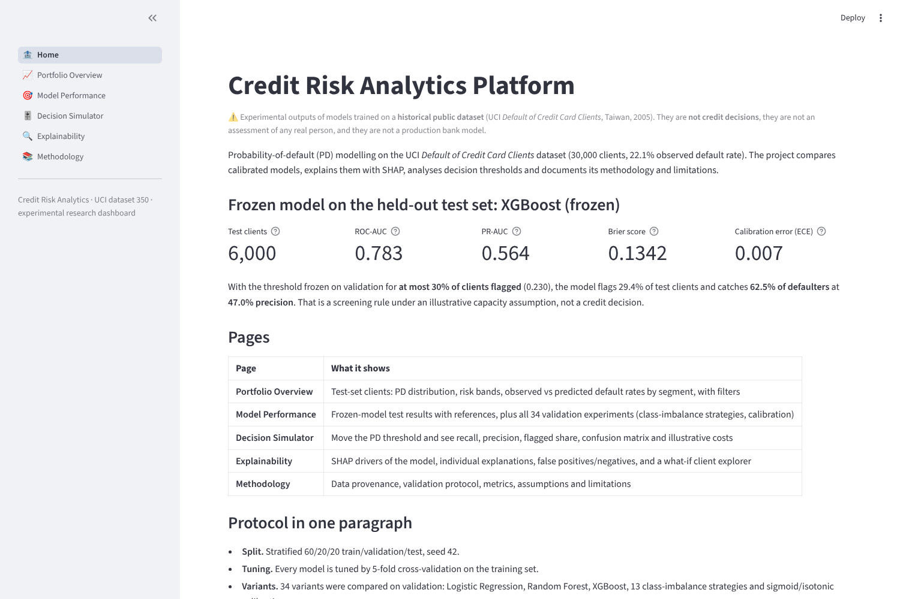
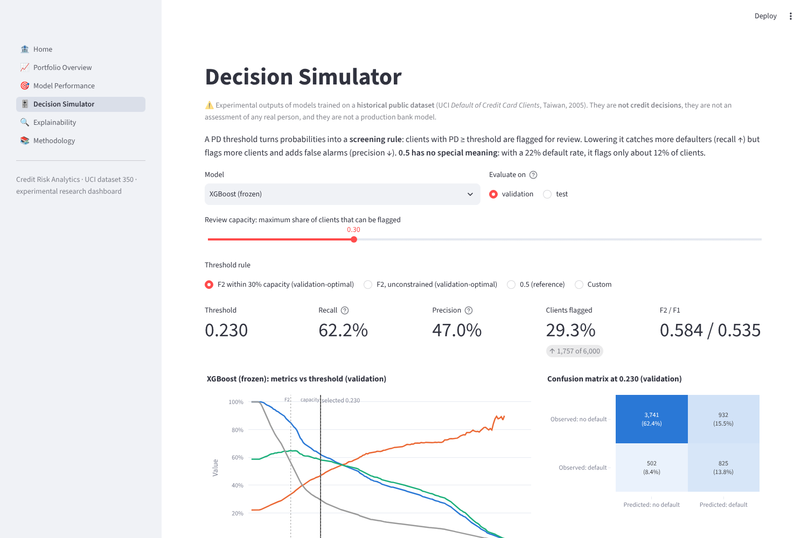
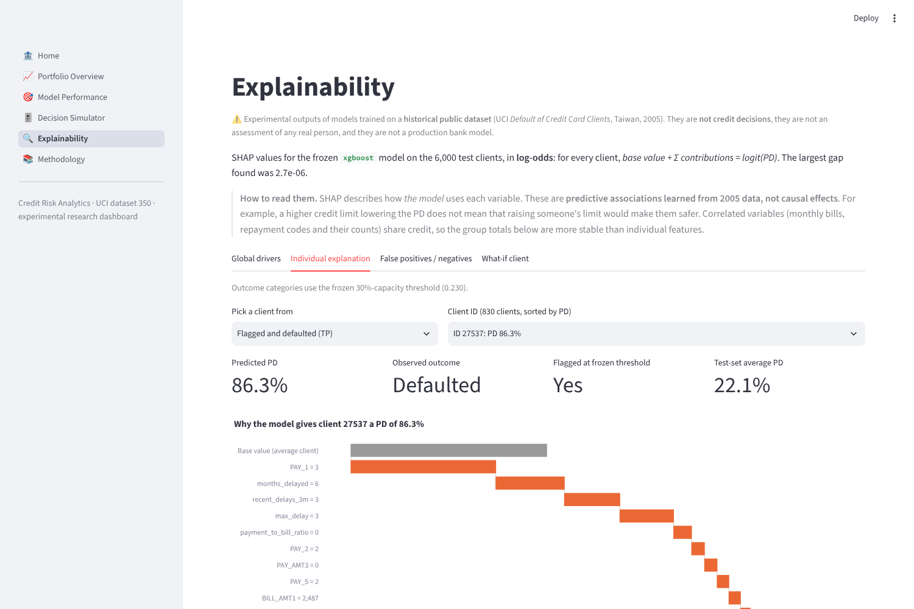

# Credit Risk Analytics Platform

End-to-end credit-risk modelling on the UCI *Default of Credit Card Clients* dataset. It covers calibrated probability-of-default models, explainability, a Streamlit dashboard, and a local RAG assistant (Ollama + ChromaDB) that cites its sources.

> **Status:** Done: data audit, modelling (34 variants incl. class-imbalance strategies and calibration), one-time test evaluation, SHAP explainability and the Streamlit dashboard. **In progress:** RAG assistant.
> All results are experimental outputs on a historical dataset. They are not credit decisions.

## Quick start (Windows 11, Anaconda Prompt)

```bat
cd %USERPROFILE%\Desktop\credit-risk-analytics
conda env create -f environment.yml
conda activate credit-risk
python scripts\check_environment.py
python scripts\audit_data.py
python scripts\run_experiments.py      # ~40 min on 20 threads; writes artifacts/
python scripts\evaluate_test.py         # one-time frozen test evaluation
python scripts\compute_shap.py          # SHAP explanations of the frozen model
pytest
streamlit run app.py                    # dashboard at http://localhost:8501
```

Windows shortcuts in `scripts/` (double-click, output in `logs/`): `run_experiments.bat` (add `--resume` to continue an interrupted run), `run_dashboard.bat`, `verify_on_pc.bat` (tests and artifact checks).

The raw dataset is not stored in Git. Download it from
[UCI dataset 350](https://archive.ics.uci.edu/dataset/350/default+of+credit+card+clients)
and place `default of credit card clients.xls` in `data/raw/`. `audit_data.py` checks its SHA-256 against the value in `configs/data.yaml`.

## Project layout (current)

```
configs/data.yaml              data source, checksum, split configuration
src/credit_risk/data.py        loading, column standardisation, feature/target separation, splits
src/credit_risk/validation.py  schema validation and data-quality report
scripts/audit_data.py          Phase 1 pipeline: validate → report → metadata → splits
scripts/check_environment.py   Python, packages, GPU and Ollama model check
scripts/run_experiments.py     tune (CV on train) + evaluate on validation, models in configs/models.yaml
src/credit_risk/features.py    deterministic behavioural feature engineering
src/credit_risk/preprocessing.py  ColumnTransformers (linear / tree)
src/credit_risk/models.py      pipelines, grid search, PD prediction
src/credit_risk/evaluation.py  metrics, calibration tables, bootstrap and paired-bootstrap CIs
src/credit_risk/decision_analysis.py  F-beta threshold selection, illustrative costs
src/credit_risk/imbalance.py   resampling strategies (SMOTE-NC, under/oversampling, Tomek, ENN, hybrids)
src/credit_risk/calibration.py sigmoid / isotonic calibration on out-of-fold training scores
src/credit_risk/selection.py   pre-declared model-selection rule -> selection.json
src/credit_risk/experiment.py  experiment runner; writes artifacts/metrics/*.json
scripts/*.bat                  Windows launchers: run_experiments (--resume), run_dashboard, verify_on_pc
notebooks/01-06_*.ipynb        audit, exploration, baselines, comparison, calibration & decisions, final test
scripts/evaluate_test.py       one-time frozen test evaluation (refuses to re-run without --force)
src/credit_risk/explainability.py  TreeSHAP, additivity check, global / grouped / local explanations
src/credit_risk/results.py     read-only interface to stored results (dashboard and RAG)
scripts/compute_shap.py        SHAP of the frozen model -> artifacts/explainability/
scripts/verify_artifacts.py    checksums, model hashes, reproduced predictions, SHAP additivity
app.py, pages/, src/dashboard/ Streamlit + Plotly dashboard
docs/data_dictionary.md        provenance, variables, quality findings, limitations
docs/methodology.md            validation protocol, features, metrics, threshold policy
data/processed/                split IDs and dataset metadata (small, versioned)
artifacts/metrics/             structured experiment results (source of truth for all figures)
artifacts/predictions/         validation-set PDs per model
reports/                       data-quality report and figures
tests/                         pytest suite
```

## Results so far

34 model variants were compared on the validation set (`artifacts/metrics/summary.json`, `comparisons.json`). A pre-declared rule selected XGBoost (`selection.json`). The model and thresholds were then frozen and evaluated **once** on the held-out test set (`test_evaluation.json`, `notebooks/06_final_test_evaluation.ipynb`).

| Test set (6,000 clients) | ROC-AUC [95% CI] | PR-AUC | Brier | ECE |
|---|---|---|---|---|
| Dummy (base rate) | 0.500 | 0.221 | 0.172 | 0.019 |
| Logistic Regression + features | 0.771 | 0.527 | 0.1377 | 0.013 |
| Random Forest | 0.779 | 0.558 | 0.1349 | 0.015 |
| **XGBoost (frozen)** | **0.783 [0.770, 0.798]** | **0.564** | **0.1342** | **0.007** |

- XGBoost vs Logistic Regression on test: ΔPR-AUC +0.037 [+0.021, +0.052]. XGBoost and Random Forest are close: +0.007 on test, and equivalent in training-set CV.
- On this dataset, none of the tested class-imbalance methods (class weights, over-/undersampling, SMOTE-NC, Tomek, ENN, hybrids, balanced ensembles) improved discrimination. All rebalancing distorted the PDs through the class-prior shift, which the analytic prior correction explains almost exactly. See notebook 04.
- With a frozen threshold flagging ≤ 30% of clients, the model catches 62.5% of test defaulters at 47% precision. That is a screening rule under stated assumptions, not a credit decision.

MLflow runs are stored in `mlflow.db`. Browse them with `mlflow ui --backend-store-uri sqlite:///mlflow.db`.

## Dashboard

`streamlit run app.py`. Every number is read from the stored experiment outputs (`src/credit_risk/results.py`). Nothing is hard-coded for display.

| Page | Content |
|---|---|
| Home | Headline test metrics of the frozen model, protocol summary |
| Portfolio Overview | Test-set PD distribution, risk bands, observed vs predicted default rate by segment, filters |
| Model Performance | Test results with CIs and paired tests; any validation model; class-imbalance and calibration experiments |
| Decision Simulator | PD threshold slider, capacity constraint, confusion matrix, illustrative user-defined costs |
| Explainability | SHAP global drivers and dependence, individual waterfalls, FP/FN analysis, validated what-if client |
| Methodology | Appropriate and inappropriate uses, limitations, full methodology and data dictionary |

Screenshots are in `reports/screenshots/`.





## Where each result was produced

| Step | Machine |
|---|---|
| Data audit, 47 tests, all 34 model fits and validation results (`run_experiments.py`) | Owner's Windows PC (20 threads), 2026-10-29 |
| Paired comparisons, selection, frozen test evaluation, SHAP, notebooks, dashboard tests | Development container (Linux), using the model files trained on the PC. Reloaded models reproduce the PC's validation predictions to within 3e-8. |
| Full test suite (68 tests), artifact checks and SHAP recomputation | Owner's PC, 2026-10-29 23:34 (`scripts\verify_on_pc.bat`): all passed. The PC reproduces the stored validation predictions (max diff 3e-8) and the SHAP values. |

## Reproducibility

- Stratified 60 / 20 / 20 train / validation / test split, `random_seed = 42`. Customer IDs are stored in `data/processed/splits.json`.
- The test set was used exactly once, for the frozen model and thresholds (`frozen_decision.json`, `test_access_count = 1`).
- Every learned transformation is fitted on the training partition inside scikit-learn pipelines (from Phase 2).

## Data source and licence

Yeh, I.-C. (2016). *Default of Credit Card Clients* [Dataset]. UCI Machine Learning Repository. https://doi.org/10.24432/C55S3H, CC BY 4.0.
